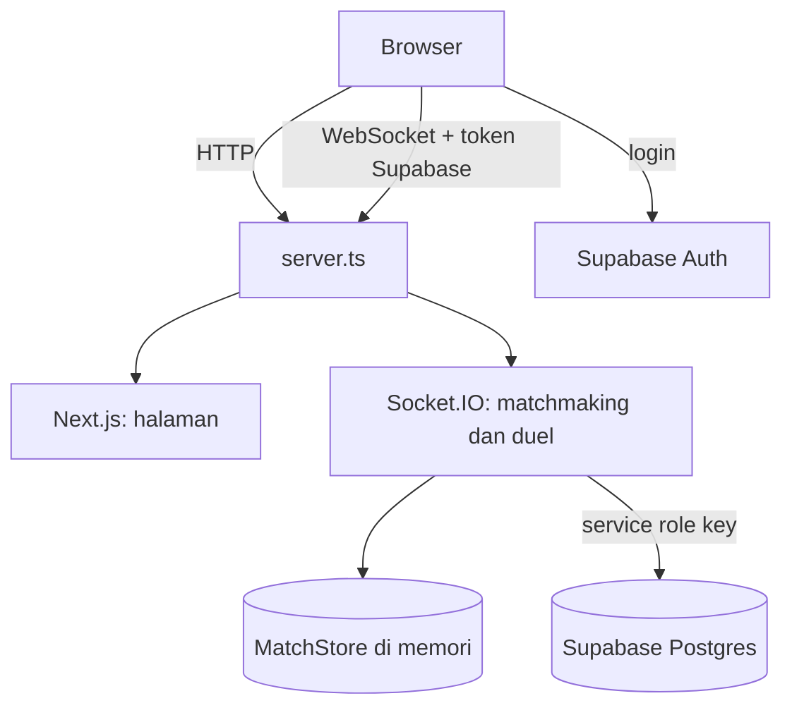

# Study-Clash-Ranked

> Proyek hackathon. Duel matematika 1 vs 1 online dengan sistem ranking dan leaderboard.

Dua pemain mendapat 5 soal yang sama dan berlomba menjawab. Makin cepat dan tepat, makin besar poinnya. Pemenang ditentukan dari total poin, lalu rating Elo masing-masing diperbarui.

## 👥 Tim

| Nama        | Peran                          | GitHub                                               |
| ----------- | ------------------------------ | ---------------------------------------------------- |
| Zalvarel    | Frontend                       | [@zalvarel](https://github.com/zalvarel)             |
| Fathir      | Logika (backend & sistem duel) | [@FatngatirBilek](https://github.com/FatngatirBilek) |
| Mazkafiqlla | Desain UI                      | [@Cranelll22](https://github.com/Cranelll22)         |

## ✨ Fitur

- **Ranked:** dicarikan lawan dengan rating berdekatan. Kalau belum ketemu dalam 10 detik, otomatis dapat bot.
- **Room:** duel dengan teman lewat kode 4 karakter.
- **Latihan Bot:** pemanasan melawan bot, tidak mengubah rating.
- **Rating Elo dan tier** (Perunggu, Perak, Emas), plus peringkat per jenjang (SD, SMP/MTs, SMA/SMK).
- **Pembahasan** tiap soal setelah duel selesai.
- **Login** dengan Google atau sebagai tamu.

## 🛠️ Tech Stack

| Lapisan         | Teknologi                                                                           |
| --------------- | ----------------------------------------------------------------------------------- |
| Frontend        | [Next.js](https://nextjs.org/) 16 (App Router, Turbopack), React 19, TypeScript     |
| Styling         | [Tailwind CSS](https://tailwindcss.com/) v4                                         |
| Realtime        | [Socket.IO](https://socket.io/) 4 (server dan klien)                                |
| Validasi        | [Zod](https://zod.dev/) untuk payload socket                                        |
| Matematika      | [KaTeX](https://katex.org/) untuk menampilkan soal                                  |
| Database & Auth | [Supabase](https://supabase.com/): Postgres, Google OAuth, login tamu (anonymous)   |
| Runtime         | [Bun](https://bun.sh/): menjalankan `server.ts` (Next.js dan Socket.IO satu proses) |

## 🏗️ Arsitektur



- `server.ts` menjalankan Next.js dan Socket.IO di port yang sama.
- Saat socket tersambung, server memverifikasi token Supabase milik pemain.
- Antrean dan duel yang sedang berjalan disimpan di memori (`InMemoryMatchStore`). Kalau server di-restart, duel yang sedang jalan hilang, dan server hanya bisa berjalan satu instance.
- Hasil duel, jawaban, dan rating ditulis ke Supabase.

## 🚀 Cara Menjalankan

Butuh [Bun](https://bun.sh/) 1.x.

```bash
git clone https://github.com/zalvarel/Study-Clash-Ranked.git
cd Study-Clash-Ranked
bun install
cp .env.example .env.local   # lalu isi nilainya
bun run dev                  # buka http://localhost:3000
```

Perintah lain:

| Perintah        | Fungsi                                                           |
| --------------- | ---------------------------------------------------------------- |
| `bun run dev`   | Jalankan server development (`bun server.ts`)                    |
| `bun run build` | Build Next.js untuk production                                   |
| `bun run start` | Jalankan server production (`NODE_ENV=production bun server.ts`) |
| `bun run lint`  | Cek kode dengan ESLint                                           |

> Jangan memakai `next dev` atau `next start` langsung. Keduanya tidak menjalankan Socket.IO, jadi pencarian lawan akan menggantung.

### Environment (`.env.local`)

| Variabel                               | Isi                                                                                     |
| -------------------------------------- | --------------------------------------------------------------------------------------- |
| `NEXT_PUBLIC_SUPABASE_URL`             | Project URL dari Supabase                                                               |
| `NEXT_PUBLIC_SUPABASE_PUBLISHABLE_KEY` | Publishable (anon) key. Aman dipakai di browser                                         |
| `SUPABASE_SERVICE_ROLE_KEY`            | **Rahasia.** Hanya untuk server. Jangan di-commit dan jangan dipakai di browser         |
| `PORT`                                 | Port server (default `3000`)                                                            |
| `ALLOWED_ORIGINS`                      | Origin yang boleh membuka socket, pisahkan dengan koma. Di production isi domain publik |

Ambil nilai Supabase di **Project Settings > API**.

### Setup Supabase

1. Buat project di [Supabase](https://supabase.com/) lalu isi `.env.local`.
2. Jalankan SQL di folder `supabase/` lewat SQL Editor, berurutan:
   1. `supabase/migrations/001_init.sql`
   2. `supabase/migrations/002_add_jenjang.sql`
   3. `supabase/seed/01_math_algebra.sql` (bank soal awal)
3. **Authentication > Sign In / Providers**: aktifkan **Google** (isi Client ID dan Secret dari Google Cloud) dan **Allow anonymous sign-ins**.
4. **Authentication > URL Configuration**: tambahkan `http://localhost:3000/auth/callback` (dan URL production) ke **Redirect URLs**.

## 🎮 Aturan Duel

Semua angka ada di [`src/shared/config.ts`](src/shared/config.ts) dan bisa diubah di sana.

| Aturan               | Nilai                                                |
| -------------------- | ---------------------------------------------------- |
| Soal per duel        | 5                                                    |
| Batas waktu per soal | 30 detik (bisa beda per soal lewat `time_limit_sec`) |
| Rating awal          | 1000                                                 |
| Rating minimum       | 100                                                  |

### Skor per soal

$$
\text{poin} =
\begin{cases}
0 & \text{jika salah atau tidak menjawab} \\[4pt]
100 + \text{round}\!\left(50 \times \max\!\left(0,\; 1 - \dfrac{t}{T}\right)\right) & \text{jika benar}
\end{cases}
$$

$t$ adalah waktu menjawab (dihitung server sejak soal dikirim) dan $T$ adalah batas waktu soal. Jawaban benar dapat 100 sampai 150 poin, jadi maksimal satu duel adalah $5 \times 150 = 750$. Jawaban salah tidak dikurangi poin. Jawaban yang masuk lewat batas waktu (toleransi sekitar 0,35 detik) tetap dapat 100 poin kalau benar, setelah itu ditolak. Pemenang ditentukan dari **total poin**, dan poin sama berarti seri.

| Waktu menjawab (T = 30 dtk) | 0 dtk | 6 dtk | 15 dtk | 24 dtk | 30 dtk |
| --------------------------- | ----- | ----- | ------ | ------ | ------ |
| Poin (benar)                | 150   | 140   | 125    | 110    | 100    |

### Rating Elo

Peluang menang (diharapkan):

$$
E = \frac{1}{1 + 10^{\,(R_{\text{lawan}} - R_{\text{kamu}})/400}}
$$

Hasil duel:

$$
S =
\begin{cases}
1 & \text{menang} \\
0{,}5 & \text{seri} \\
0 & \text{kalah}
\end{cases}
$$

Perubahan rating dan rating baru:

$$
\Delta = \text{round}\big(K \times (S - E)\big)
\qquad
R_{\text{baru}} = \max\big(100,\; R_{\text{lama}} + \Delta\big)
$$

$K = 40$ untuk 10 duel pertama, lalu $K = 20$. Contoh perubahan rating:

| Selisih rating        | Menang (K=20 / K=40) | Kalah (K=20 / K=40) |
| --------------------- | -------------------- | ------------------- |
| Sama                  | +10 / +20            | −10 / −20           |
| Kamu lebih tinggi 100 | +7 / +14             | −13 / −26           |
| Kamu lebih rendah 100 | +13 / +26            | −7 / −14            |

### Tier

Tier hanya tampilan di frontend, dihitung dari rating:

| Tier     | Rating       |
| -------- | ------------ |
| Perunggu | di bawah 900 |
| Perak    | 900 – 1199   |
| Emas     | 1200 ke atas |

Karena rating awal 1000, pemain baru langsung mulai di Perak.

### Mode duel

| Mode            | Cara lawan didapat                                            | Rating berubah?                              |
| --------------- | ------------------------------------------------------------- | -------------------------------------------- |
| **Ranked**      | Matchmaking berdasarkan rating                                | Ya                                           |
| **Room**        | Host membuat kode 4 karakter, teman bergabung dengan kode itu | Ya                                           |
| **Latihan Bot** | Langsung dapat bot, tanpa antre                               | Tidak (rating dan jumlah duel tidak berubah) |

**Matchmaking Ranked:** server mengecek antrean tiap 0,5 detik.

- Jendela rating awal ±200, bertambah 50 tiap 3 detik menunggu:

  $$
  \text{jendela} = 200 + 50 \times \left\lfloor \frac{\text{lama menunggu (detik)}}{3} \right\rfloor
  $$

- Awalnya hanya mencari lawan satu jenjang. Setelah 1,5 detik, jenjang diabaikan dan jendelanya dua kali lebih lebar.
- Setelah 10 detik tanpa lawan, pemain otomatis dipasangkan dengan bot (dihitung sebagai latihan, rating tidak berubah).

**Bot:** rating bot sekitar rating pemain ($\pm 40$). Peluang bot menjawab benar naik sesuai rating bot, dengan batas bawah 40% dan batas atas 92%:

$$
p_{\text{benar}} = \min\!\left(0{,}92,\; \max\!\left(0{,}4,\; \frac{R_{\text{bot}} - 800}{1000} + 0{,}45\right)\right)
$$

Waktu menjawab bot acak antara 3 detik dan sekitar 22 detik.

**Pemilihan soal:** soal diacak dari tabel `questions`. Kalau kedua pemain satu jenjang, kesulitan mengikuti jenjang itu (SD 1–2, SMP/MTs 2–4, SMA/SMK 3–5). Kalau jenjang berbeda, kesulitan dipilih dari rata-rata rating supaya adil untuk keduanya.

**Putus koneksi:** ada masa tenggang 10 detik untuk tersambung kembali. Kalau tidak kembali, duel dibatalkan.

## 📄 Halaman

| Route            | Isi                                                             |
| ---------------- | --------------------------------------------------------------- |
| `/`              | Redirect ke `/login`                                            |
| `/login`         | Masuk dengan Google atau main sebagai tamu                      |
| `/auth/callback` | Menunggu session dari Google lalu mengarahkan ke `/lobby`       |
| `/lengkapi`      | Melengkapi profil (jenjang dan sekolah)                         |
| `/lobby`         | Beranda: kartu Ranked, Room, Latihan Bot, dan peringkat singkat |
| `/cari`          | Mencari lawan (Ranked, Bot, dan lobby Room)                     |
| `/duel`          | Layar duel                                                      |
| `/hasil`         | Hasil duel dan perubahan rating                                 |
| `/pembahasan`    | Pembahasan soal yang salah                                      |
| `/terputus`      | Tampilan saat koneksi terputus                                  |
| `/peringkat`     | Leaderboard                                                     |
| `/profil`        | Profil dan statistik                                            |
| `/pengaturan`    | Pengaturan                                                      |
| `/bantuan`       | Bantuan dan privasi                                             |

## 📁 Struktur Folder

```
app/          Halaman Next.js (App Router)
components/   Komponen UI (components/ui, components/duel, components/profil)
lib/          Kode sisi klien: auth, socket, state duel, konfigurasi UI
src/server/   Logika server: matchmaking, duel engine, akses database
src/shared/   Kode yang dipakai klien dan server: aturan duel, skema event
supabase/     Migrasi dan seed SQL
server.ts     Entry point: Next.js + Socket.IO
```

> **Penting:** `src/server/db.ts` memakai `SUPABASE_SERVICE_ROLE_KEY`. Jangan pernah mengimpornya dari `app/` atau `components/`, karena key rahasia bisa ikut terbawa ke browser.

## 🌐 Deploy

1. Isi `.env.local` di server (termasuk `ALLOWED_ORIGINS` dengan domain publik).
2. `bun install` lalu `bun run build`.
3. Jalankan `bun run start`, misalnya sebagai service systemd.
4. Pasang reverse proxy (mis. Caddy) ke port `PORT`. Pastikan WebSocket ikut diteruskan.
5. Setiap habis `bun run build`, **restart service** supaya kode baru dipakai. Restart akan memutus duel yang sedang berjalan.

## 🤝 Kontribusi

Baca [CONTRIBUTING.md](CONTRIBUTING.md) sebelum mulai kerja.
